<div align="center">

# MiniWin Runtime

**Real Windows programs and games — running on Linux, no Wine, no VM, no recompilation.**

*The minimum Windows that applications actually need — discovered program by program, fix by fix.*

    

**[Release v0.001](https://github.com/Sh-TB/miniwin-engineering/releases/tag/v0.001)** · evidence-based · zero-regression discipline · AI-assisted engineering

</div>

---

## What is MiniWin?

MiniWin is a **Windows x64/PE32 runtime compatibility layer for Linux**, built on one
principle: *implement only the behavior that real applications actually use — nothing
more, nothing guessed*. Real Windows binaries are loaded, their imports resolved, their
code executed — and every crash becomes a decoded root cause that becomes a permanent
engine capability. No Wine, no virtual machine, no recompilation of the guest.

It runs **actual famous Windows software** — PuTTY, Notepad++ (x86 and x64), WinRAR,
7-Zip, IDM-class installers, VLC, qBittorrent, Audacity, ShareX, ripgrep, bat, SteamCMD,
the 70MB Stockfish chess engine — plus the full XP classics suite (Minesweeper,
Solitaire, Freecell, Spider, Hearts, Calculator, WordPad, Paint, Task Manager…).

## Real screenshots — rendered by the engine, first try, no edits

| | | |
|:---:|:---:|:---:|
| **Spider Solitaire** (full 1024×768 board) | **Solitaire** (complete deal) | **Freecell** |
|  | 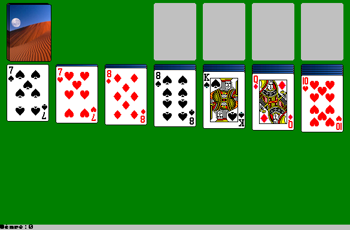 | 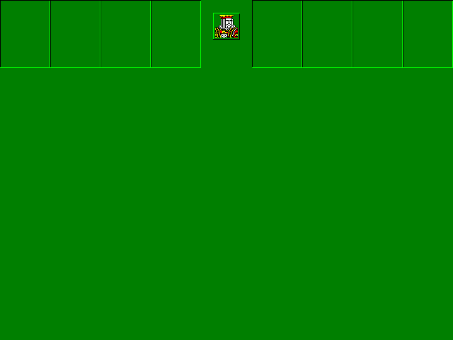 |
| **Minesweeper** (interactive play) | **Minesweeper** (game over — bombs & flags) | **Breakout** (game loop) |
| 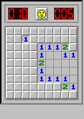 | 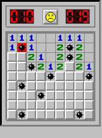 | 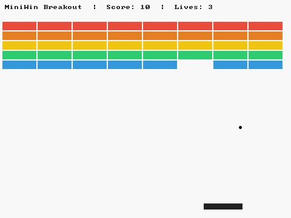 |
| **PuTTY** (its genuine error dialog) | **Notepad++ x64** (real first-run MessageBox) | **WinRAR** (its own Error dialog) |
| 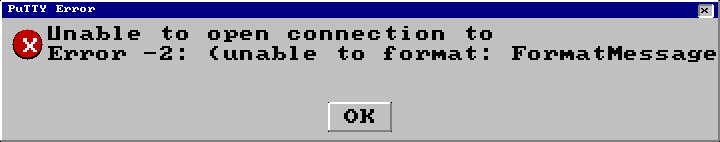 | 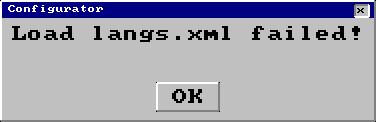 | 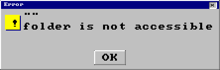 |
| **Calculator** | **Snake** | **Minesweeper** (classic) |
| 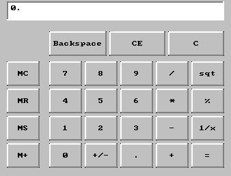 | 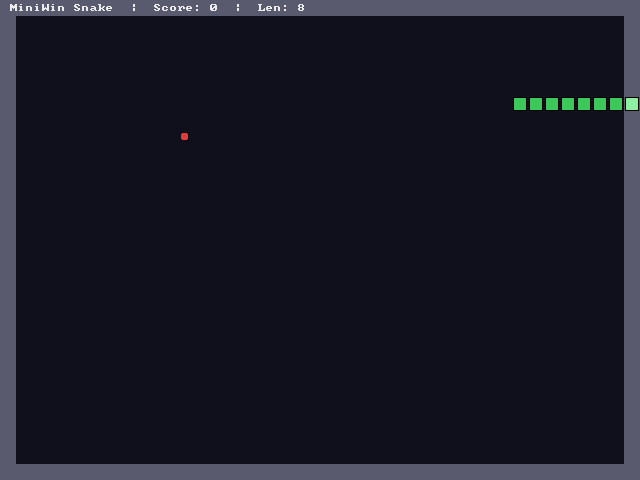 | 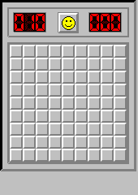 |

Every image above is a real BMP frame captured from a live MiniWin run — games are
playable via the mouse-event channel (flood-fill reveals, classic 1=blue/2=green
numbers, LED timer, game-over bomb art).

## By the numbers — v0.001

| Metric | Value |
|---|---|
| **Engine binary** (`minwin_loader`) | **4.1 MB** — one C translation unit, zero external deps beyond libc/sqlite3 |
| **Engine source** | **41,857 lines** (`src/loader/loader.c` 41,579 + `include/pe.h` 278) |
| **Build** | `make` — gcc -O2, **~2 minutes**, no cross-toolchain needed |
| **Guest corpus** | **66 programs & games** staged + run |
| **Battery throughput** | 29 guests in one parallel wave (~7 min, xargs -P6) |
| **Deepest penetration** | 794,322 guest steps (DriverView past UPX into real OEP) · 47,478 steps (7-Zip installer) · 100M+ steps (Notepad++ x86) |
| **Biggest guest** | Stockfish 16.1 AVX2 — **70 MB** (the old 64MB loader cap is history) |
| **Regression gate** | G1 PIN 12/12 + corpus ×3 determinism, every single commit |
| **Sweeps landed** | SWEEP-030 → 070 — 40+ sweeps, ~10 engine root-cause classes fixed |

## Load fidelity — exactly like Windows

MiniWin replicates the **Windows load sequence** step by step: MZ/PE parse → section
mapping → relocations → flat IAT import resolution (arity-verified against Wine
`.spec` files) → TLS/SEH setup → CRT startup → `RegisterClass`/`CreateWindow` →
message pump with real frame rendering. Guest programs make **their own decisions**
on this path — PuTTY opens a connection, fails honestly, and renders *its own* error
dialog; WinRAR shows *its own* "folder is not accessible" box; WordPad reports its
document failure — exactly like on Windows.

| Behavior class | Examples |
|---|---|
| Clean Windows-like run | ShareX (.NET/CRT+CLR path), bat, ripgrep, autologon64, 5 Sysinternals, 6 XP apps |
| Own dialogs rendered | PuTTY, WinRAR, Notepad++ x64 (2 messageboxes), sndvol32, wordpad, snake |
| Deep real-code execution | DriverView 794K steps, heapmemview 794K, iconsext 603K, 7-Zip 47K, everything 5K |
| GUI games, playable | winmine (interactive), sol, freecell, spider, breakout, snake, mshearts |

## How it works

```
┌────────────────────────────────────────────────────────────┐
│  real .exe (x64/PE32+, unmodified)                         │
│      │                                                     │
│      ▼                                                     │
│  loader: MZ/PE parse · section map · relocs · flat IAT     │
│      │        (2,900+ imports, arity-checked vs wine.spec) │
│      ▼                                                     │
│  engine: x86-64 + x86 interpreter · SEH/C++ EH unwind      │
│          GDT/IDT · fastfail honesty · crash recorder       │
│      ▼                                                     │
│  win32 layer: USER32/GDI32/KERNEL32/… app-driven models    │
│      │        (only what guests really call — measured)    │
│      ▼                                                     │
│  output: frames (BMP) · messageboxes · stdout · exit codes │
└────────────────────────────────────────────────────────────┘
```

**Evidence-based discipline**: every sweep commits its measured table (exit codes,
frames, steps) to `evidence/sweepNNN/`; every fix must reproduce deterministically 3×;
a 12-case G1 gate pins the build before any push. Regressions are caught by the gate,
not by users.

## Quick start

```bash
git clone https://github.com/Sh-TB/miniwin-engineering.git
cd miniwin-engineering && make          # ~2 min, gcc only

# run a real Windows program
MW_GUI_EVENTS=1 MW_GUI_EVENTS_BUDGET=300 ./minwin_loader artifacts/sweep061/guests/winmine/winmine.exe
ls miniwin-results/winmine.exe/screenshots/    # 82 rendered frames

# run a famous one (fetches 498MB corpus of real installers)
bash scripts/sweep070_download.sh && bash scripts/sweep070_battery.sh
```

## Corpus highlights (66 programs — all real binaries)

- **Famous software**: IDM 6.42 · VLC 3.0.21 · qBittorrent · Audacity · MPC-HC ·
  WinMerge · Everything · CPU-Z · PuTTY · 7-Zip · NVM · yt-dlp · ShareX · ripgrep ·
  bat · NSSM · SteamCMD · WinRAR 7.12 · Notepad++ 8.9.8.1 (x86 + x64)
- **Games**: Minesweeper · Solitaire · Freecell · Spider · Hearts · Breakout · Snake ·
  Stockfish (chess, 70MB)
- **XP suite**: calc · charmap · clipbrd · drwtsn32 · mspaint · notepad · regedt32 ·
  sndvol32 · taskmgr · winver · wordpad · write
- **Sysinternals x64 (15)**: accesschk · autologon · du · handle · listdlls ·
  logonsessions · pipelist · pslist · psloggedon · PsInfo · PsService · sdelete ·
  strings · whois · curl
- **NirSoft (14)**: usbdeview · driverview · devmanview · dnsquerysniffer · faview ·
  heapmemview · htmlastext · iconsext · installedappview · multimonitortool ·
  recentfilesview · resourcesextract · simpleprogramdebugger · urlprotocolview

## Roadmap — active wagons

| Car | Mission |
|---|---|
| SW-1298-x64 | Notepad++ x64 first-run crash (RVA 0x3b94) — renders 2 real dialogs already |
| SW-1309 | 551–565-step installer-init family (Audacity/CPU-Z/MPC-HC/NVM) |
| SW-1310 | Corrected-asset hunt: OpenTTD, SuperTux, AutoHotkey, SumatraPDF |
| SW-1311 | Stockfish 70MB post-load SIGABRT |
| SW-1312 | yt-dlp PyInstaller x64 bootstrap |
| SW-1302/1305/1306/1307/1308 | NirSoft OEP deep-divers · handle64 · gup A/B · logonsessions EH chain |

## Repository map

| Path | What lives there |
|---|---|
| `src/loader/loader.c` | the whole engine (41.6K lines) |
| `evidence/sweep030..070/` | per-sweep measured tables, reports, screenshots |
| `scripts/sweep0NN_*.sh` | reproducible battery + download harnesses |
| `docs/ARCHITECTURE.md`, `docs/BUILD_GUIDE.md` | deep engineering docs |
| `docs/KNOWLEDGE_TRANSFER.md` | full engineering history & concept |
| `artifacts/sweep0NN/` | guest binaries & staged corpus |
| `CHANGELOG.md` | every sweep, every fix — Keep-a-Changelog format |

---

<div align="center">

**v0.001** — first tagged release · the train rolls on.

</div>
